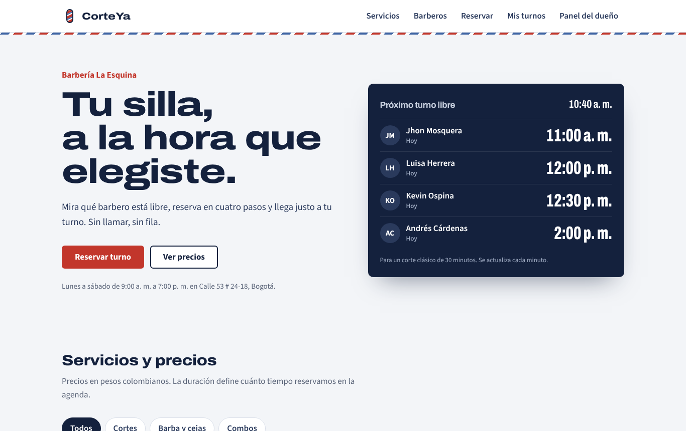
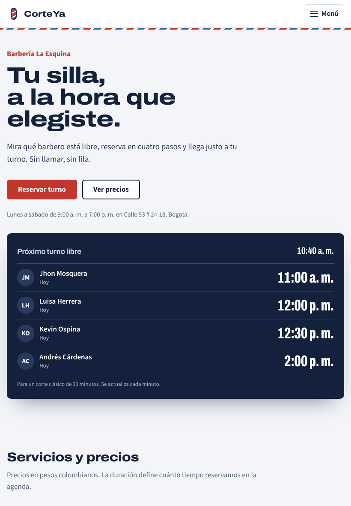
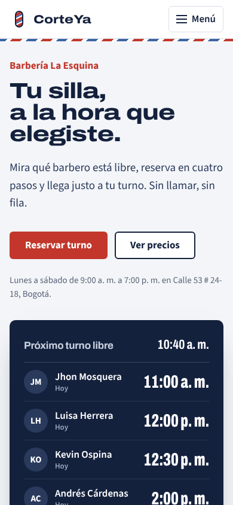

# CorteYa

Plataforma web de gestión de turnos para barberías pyme en Colombia.

CorteYa permite que el cliente consulte la disponibilidad y reserve su turno desde el celular, que el barbero organice su agenda del día y que el dueño del negocio controle servicios, horarios e indicadores como la ocupación y las inasistencias.

Este repositorio contiene el **prototipo web inicial** (primera fase del proyecto). Funciona con datos simulados y no requiere servidor, base de datos ni autenticación.

## Integrantes

- Santiago Rios Duque
- Isaac Stiven Nuñez Melo
- Juan Sebastian Muñoz Melo

## Problema que atiende

La mayoría de las barberías pequeñas toma las citas por llamada, por WhatsApp o en un cuaderno. Eso provoca turnos cruzados, espacios vacíos que nadie sabía que estaban libres, inasistencias sin recordatorio y ninguna información confiable para tomar decisiones.

## Objetivo general

Diseñar y construir CorteYa, una plataforma web de gestión de turnos para barberías pyme en Colombia, basada en una API REST con Node.js y Express, una interfaz web y una base de datos relacional, que pueda construirse, probarse y desplegarse en la nube de manera incremental durante el semestre.

## Alcance inicial (esta entrega)

El prototipo representa la funcionalidad principal del producto mínimo viable:

| Sección | Qué permite hacer |
|---|---|
| Inicio | Ver en vivo el próximo turno libre de cada barbero. |
| Servicios | Consultar el catálogo con precio y duración, filtrado por categoría. |
| Barberos | Conocer al equipo, su especialidad y su próximo espacio libre. |
| Reservar | Reservar un turno en cuatro pasos: servicio, barbero, fecha y hora, y datos de contacto. Solo se ofrecen horas libres, sin cruces con otros turnos ni con el almuerzo del barbero. |
| Mis turnos | Ver los turnos reservados en este navegador y cancelarlos. |
| Panel del dueño | Indicadores del día (turnos, ocupación, inasistencias e ingresos estimados), gráfica de turnos por hora y agenda filtrable donde se marca cada turno como atendido o no asistió. |

Elementos interactivos incluidos: menú de navegación adaptable, filtros de servicios, formulario de reserva por pasos con validación, cálculo de disponibilidad, cancelación de turnos, gráfica del panel y agenda con filtros y cambio de estado.

Quedan para las siguientes entregas: la API REST en Node.js/Express, la base de datos PostgreSQL con Sequelize, la autenticación con JWT y OAuth 2.1, los recordatorios por correo y el despliegue con Docker, Kubernetes y GitHub Actions.

## Tecnologías utilizadas

- **HTML5** semántico (secciones, formularios accesibles, atributos ARIA).
- **CSS3** con variables, Flexbox, CSS Grid y media queries (diseño adaptable a computador, tableta y celular).
- **JavaScript** (ES2020, sin frameworks) para la lógica de disponibilidad, la interactividad y el renderizado de datos simulados.
- **localStorage** para conservar los turnos reservados en el navegador.
- **Google Fonts** (Archivo y Source Sans 3).
- **Visual Studio Code**, **Git** y **GitHub**.

Se eligió JavaScript sin frameworks para esta fase porque el objetivo es aplicar los fundamentos de desarrollo web. La interfaz se migrará a React cuando se conecte con la API.

## Estructura del proyecto

```
corteya/
├── index.html              Página principal (todas las secciones)
├── css/
│   ├── base.css            Variables de diseño, tipografía y reset
│   ├── layout.css          Encabezado, navegación, secciones y pie de página
│   └── components.css      Tarjetas, formulario, ticket, panel y gráfica
├── js/
│   ├── data.js             Datos simulados: negocio, barberos, servicios y turnos
│   ├── agenda.js           Reglas de negocio: horarios, solapamiento y disponibilidad
│   ├── storage.js          Lectura y escritura segura en localStorage
│   ├── ui-catalogo.js      Inicio, servicios y barberos
│   ├── ui-reserva.js       Formulario de reserva y "Mis turnos"
│   ├── ui-panel.js         Panel del dueño: indicadores, gráfica y agenda
│   └── main.js             Navegación y arranque de la aplicación
├── assets/img/             Logo e ícono
└── docs/evidencias/        Capturas del prototipo en distintos tamaños de pantalla
```

## Cómo ejecutar el prototipo

No necesita instalación.

1. Clonar el repositorio:
   ```bash
   git clone https://github.com/<usuario>/corteya.git
   cd corteya
   ```
2. Abrir `index.html` con doble clic en un navegador actualizado (Chrome, Edge, Firefox o Safari).

Opcionalmente, con la extensión **Live Server** de Visual Studio Code: clic derecho sobre `index.html` y luego **Open with Live Server**.

Para volver a los datos iniciales, borrar los datos del sitio en el navegador o usar el botón **Borrar mis turnos** en la sección Mis turnos.

## Evidencias de funcionamiento

| Computador | Tableta | Celular |
|---|---|---|
|  |  |  |

Más capturas en [`docs/evidencias`](docs/evidencias): el formulario de reserva, el ticket de confirmación y el panel del dueño.

## Estrategia de ramas

El proyecto sigue GitFlow: `main` guarda las versiones entregadas, `develop` integra el trabajo en curso y cada funcionalidad nueva se desarrolla en una rama `feature/<nombre>` que se integra mediante pull request.
