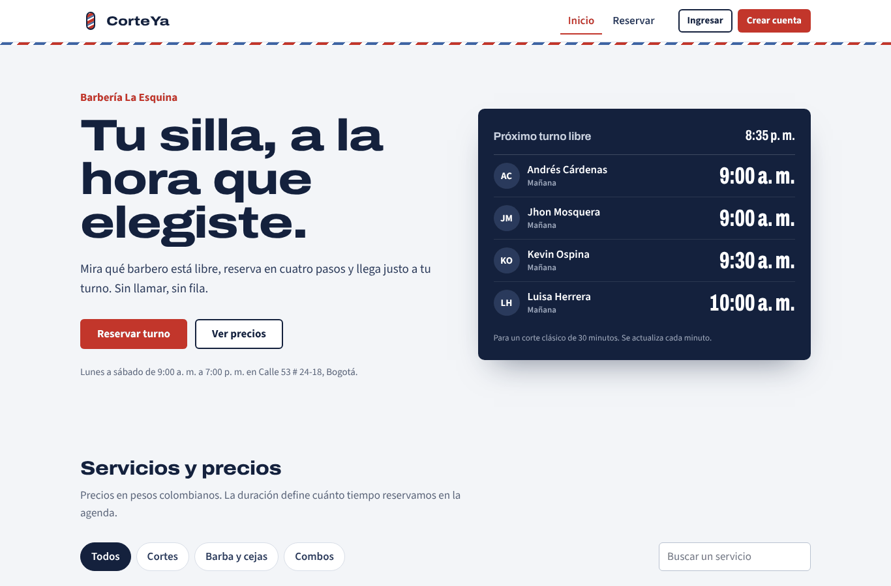
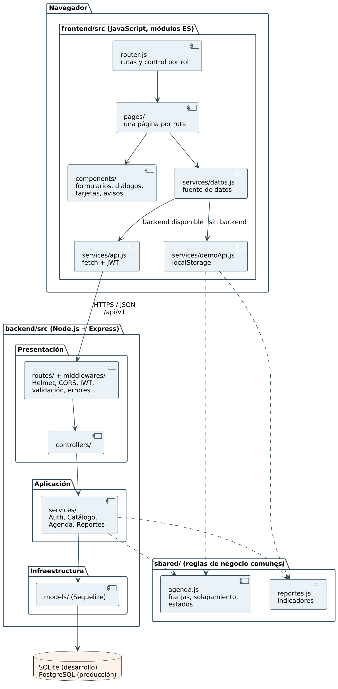
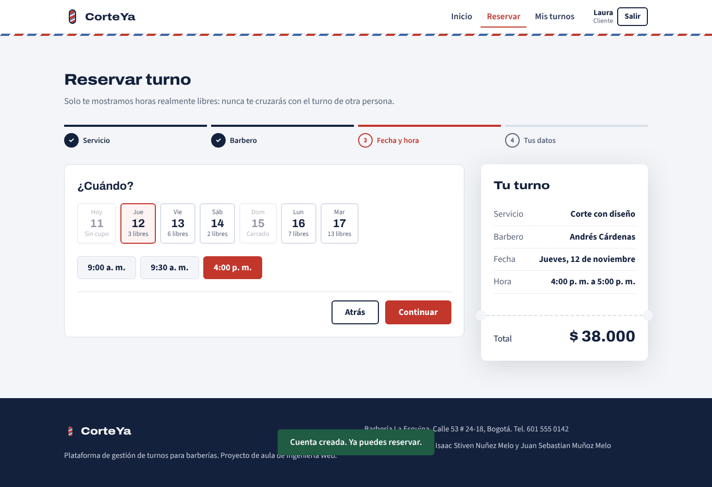
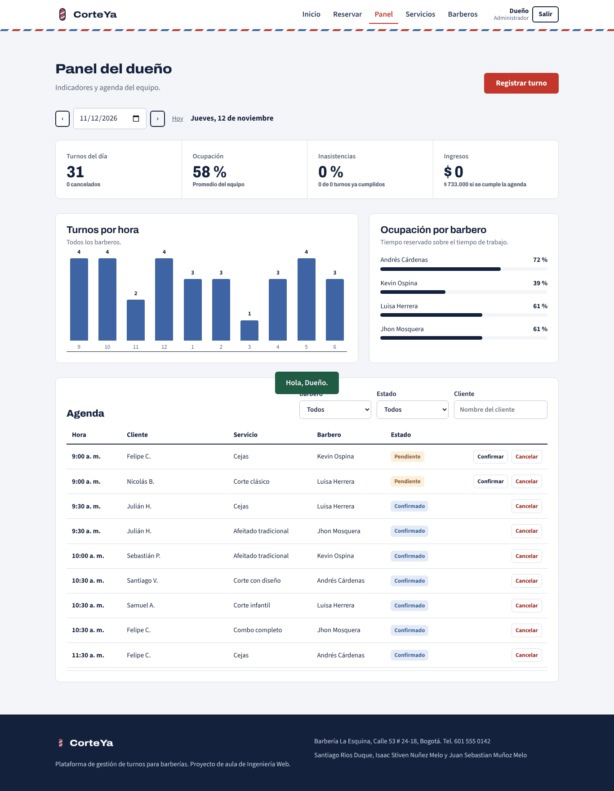
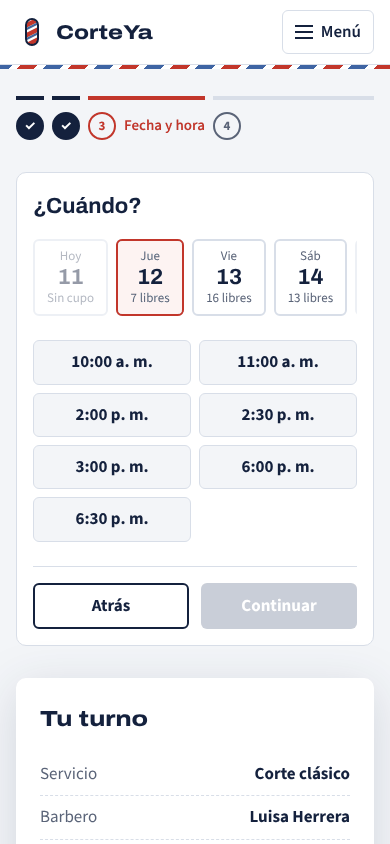

# CorteYa

**Plataforma web de gestión de turnos para barberías pyme en Colombia.**

El cliente reserva desde el celular solo en horas realmente libres, el barbero organiza su agenda del día y el dueño administra servicios, equipo e indicadores del negocio.

- **Producto publicado (modo demostración):** <https://guachulol0345896-pixel.github.io/CorteYa/>
- **Documentación de la API (al ejecutar localmente):** <http://localhost:3000/api/docs>
- **Estado:** versión final `v3.0.0`



---

## Información general

### Problemática

La mayoría de las barberías pequeñas toma las citas por llamada, por WhatsApp o en un cuaderno. El negocio no tiene una vista única de su agenda: hay turnos cruzados, espacios vacíos que nadie sabía que estaban libres, clientes que no llegan sin recordatorio ni confirmación, y ninguna información sobre ocupación, servicios más vendidos o inasistencias. Las plataformas de reservas del mercado suelen ser genéricas, costosas o cobradas en moneda extranjera.

### Justificación

En un negocio cuyo único inventario es el tiempo, un turno perdido no se recupera. Digitalizar la agenda evita cruces, reduce los tiempos muertos y entrega datos para decidir horarios y precios. Para la asignatura, el proyecto integra en un caso real la arquitectura cliente-servidor, el diseño de APIs REST, la persistencia con ORM, la autenticación con JWT, la seguridad web, las pruebas y el despliegue continuo.

### Objetivos

**General:** construir una plataforma web de gestión de turnos para barberías pyme, basada en una API REST con Node.js y Express, una interfaz web adaptable y una base de datos relacional, que evite los cruces de horario y entregue indicadores para la toma de decisiones.

**Específicos:**

1. Diseñar una arquitectura cliente-servidor por capas con reglas de negocio compartidas.
2. Implementar la reserva de turnos con validación de disponibilidad y control de concurrencia.
3. Gestionar usuarios con roles (cliente, barbero y administrador), autenticación JWT y autorización por recurso.
4. Ofrecer al administrador la gestión del catálogo y del equipo, y un panel de indicadores.
5. Asegurar la calidad con pruebas automatizadas, controles de seguridad OWASP e integración continua.
6. Publicar el producto y documentar su arquitectura, uso y operación.

### Alcance

Incluido: registro e inicio de sesión, catálogo con búsqueda y filtros, disponibilidad por barbero, reserva en cuatro pasos, mis turnos con cancelación, agenda del barbero, panel del dueño, turnos de mostrador, CRUD de servicios y barberos, API REST documentada, pruebas y despliegue.

Fuera de alcance: pagos en línea, facturación electrónica, recordatorios por correo o WhatsApp, inicio de sesión con Google y varias sedes.

---

## Información técnica

### Tecnologías

| Capa | Tecnología |
|---|---|
| Frontend | HTML5, CSS3 (variables, Grid, Flexbox, media queries), JavaScript con módulos ES, enrutador por hash |
| Backend | Node.js 20+, Express 4 |
| Datos | Sequelize 6 con SQLite (desarrollo) y PostgreSQL (producción) |
| Seguridad | bcryptjs, JSON Web Tokens, Helmet (CSP), CORS, express-validator, express-rate-limit |
| Documentación de API | OpenAPI 3.0 y Swagger UI |
| Pruebas | `node:test`, supertest |
| Observabilidad | prom-client (`/metrics`) |
| DevOps | Git y GitHub (GitFlow), GitHub Actions, GitHub Pages, Docker, Render |

### Arquitectura

Cliente-servidor con una SPA y una API REST. El backend se organiza en capas (rutas y middlewares, controladores, servicios y modelos) y el frontend en componentes, páginas, servicios y utilidades. Las reglas de la agenda están en `shared/` y las usan el backend y el frontend.



Detalle en [documentacion/arquitectura/arquitectura.md](documentacion/arquitectura/arquitectura.md) y decisiones en [documentacion/decisiones_tecnicas/decisiones.md](documentacion/decisiones_tecnicas/decisiones.md).

### Estructura del proyecto

```
CorteYa/
├── backend/src/        API REST: config, db, models, services, controllers, routes, middlewares, docs
├── frontend/           index.html, css/, assets/, src/ (components, pages, services, utils)
├── shared/             Reglas de negocio compartidas: agenda, reportes, negocio, datos iniciales
├── tests/              Pruebas: shared/, frontend/, backend/
├── documentacion/      arquitectura, diagramas, requerimientos, pruebas, manual_usuario,
│                       manual_tecnico, decisiones_tecnicas, sustentacion, entregas
├── scripts/            Servidor estático para el modo demostración
├── .github/workflows/  ci.yml (pruebas) y pages.yml (despliegue)
├── Dockerfile, docker-compose.yml, render.yaml
├── .env.example        Plantilla de configuración (el .env real no se sube)
└── package.json
```

### Dependencias

Producción: `express`, `sequelize`, `sqlite3`, `pg`, `pg-hstore`, `bcryptjs`, `jsonwebtoken`, `helmet`, `cors`, `express-rate-limit`, `express-validator`, `swagger-ui-express`, `yaml`, `prom-client`, `dotenv`. Desarrollo: `supertest`. El frontend no tiene dependencias. `npm audit`: 0 vulnerabilidades.

### Requisitos

- Node.js 20 o superior y npm.
- No requiere instalar una base de datos para desarrollo (usa SQLite).

### Instalación

```bash
git clone https://github.com/guachulol0345896-pixel/CorteYa.git
cd CorteYa
npm install
cp .env.example .env        # en Windows: copy .env.example .env
```

### Configuración

Las variables están documentadas en [`.env.example`](.env.example). Las principales son `PORT`, `JWT_SECRET` (obligatoria en producción), `DATABASE_URL` (para usar PostgreSQL) y `SEMBRAR_DATOS`.

### Ejecución

```bash
npm start          # http://localhost:3000 (aplicación y API)
npm run seed       # reinicia la base con datos de demostración de la semana actual
npm test           # 70 pruebas automatizadas
npm run dev        # modo desarrollo con recarga automática
```

Con Docker y PostgreSQL: `docker compose up --build`.

**Cuentas de demostración**

| Rol | Correo | Contraseña |
|---|---|---|
| Cliente | cliente@corteya.co | Cliente123* |
| Barbero | andres@corteya.co | Barbero123* |
| Dueño | admin@corteya.co | Admin123* |

---

## Funcionalidades

### Módulos desarrollados

| Módulo | Funcionalidades |
|---|---|
| Autenticación y usuarios | Registro, inicio de sesión, sesión con JWT, roles, rutas protegidas, límite de intentos |
| Catálogo | Servicios con categoría, duración y precio; búsqueda y filtros; CRUD con borrado lógico |
| Equipo | Barberos con especialidad, servicios que prestan y almuerzo; CRUD |
| Agenda y turnos | Disponibilidad a 7 días, reserva en 4 pasos, control de solapamiento y concurrencia, máquina de estados, cancelación hasta 2 horas antes, turnos de mostrador |
| Panel | Indicadores del día (turnos, ocupación, inasistencias, ingresos), turnos por hora, ocupación por barbero, agenda con filtros |
| Plataforma | Diseño adaptable, accesibilidad (teclado, etiquetas, mensajes por campo), manejo de errores, modo demostración |

### Integraciones

- Frontend y backend por API REST con JSON y JWT (`frontend/src/services/api.js`).
- Base de datos relacional mediante ORM (SQLite o PostgreSQL).
- Documentación OpenAPI servida por la propia API (`/api/docs`).
- Métricas en formato Prometheus (`/metrics`).
- GitHub Actions para pruebas y publicación en GitHub Pages.

---

## Pruebas

**Estrategia:** pruebas unitarias de las reglas de negocio y validaciones, pruebas de integración de cada endpoint con base de datos real, pruebas de seguridad y recorridos funcionales en el navegador por cada rol y tamaño de pantalla.

**Resultados:** 70 de 70 pruebas automatizadas aprobadas (también se ejecutaron contra PostgreSQL 16) y 21 casos funcionales aprobados sin errores en la consola. Se destaca que de cinco reservas simultáneas para la misma franja solo una se acepta.

Plan, casos y evidencias: [documentacion/pruebas/plan_y_resultados.md](documentacion/pruebas/plan_y_resultados.md).

| Reserva | Panel del dueño | Celular |
|---|---|---|
|  |  |  |

---

## Despliegue

| Entorno | Dirección | Plataforma | Acceso |
|---|---|---|---|
| Producto publicado (modo demostración) | <https://guachulol0345896-pixel.github.io/CorteYa/> | GitHub Pages, publicado por GitHub Actions en cada push a `main` | Abrir el enlace y usar las cuentas de demostración. Los datos se guardan en el navegador. |
| Producto completo | `http://localhost:3000` | Node.js local, Docker o Render (`render.yaml`) | Seguir la sección Ejecución |

Para activar GitHub Pages: **Settings → Pages → Source: GitHub Actions**. Instrucciones de Render y Docker en el [manual técnico](documentacion/manual_tecnico/manual_tecnico.md).

---

## Documentación

| Documento | Contenido |
|---|---|
| [Requerimientos](documentacion/requerimientos/requerimientos.md) | Actores, requerimientos funcionales y no funcionales, reglas de negocio |
| [Arquitectura](documentacion/arquitectura/arquitectura.md) | Componentes, flujo de información, modelo de datos, seguridad, despliegue |
| [Diagramas](documentacion/diagramas/) | Arquitectura, entidad-relación, casos de uso, clases, secuencia y despliegue (PNG y fuente PlantUML) |
| [Decisiones técnicas](documentacion/decisiones_tecnicas/decisiones.md) | Diez decisiones con contexto y consecuencias |
| [Pruebas](documentacion/pruebas/plan_y_resultados.md) | Estrategia, resultados y evidencias |
| [Manual de usuario](documentacion/manual_usuario/manual_usuario.md) | Uso por rol |
| [Manual técnico](documentacion/manual_tecnico/manual_tecnico.md) | Instalación, configuración, API, despliegue y solución de problemas |
| [Guía de sustentación](documentacion/sustentacion/guia_sustentacion.md) | Guion de la demostración y preguntas de la auditoría |
| [Documento maestro](documentacion/entregas/CorteYa_Documento_Maestro.docx) | Primera entrega en formato APA |

---

## Evolución del proyecto

| Fase | Etiqueta | Resultado |
|---|---|---|
| Fase I: repositorio y prototipo | `v1.0.0-fase1` | Página principal en HTML, CSS y JavaScript con datos simulados |
| Fase II: producto web modular | `v2.0.0-fase2` | Componentes y páginas, enrutador, roles, CRUD, pruebas de reglas de negocio |
| Entrega final | `v3.0.0-final` | Backend con API REST, base de datos, JWT, seguridad, integración, CI/CD, despliegue y documentación completa |

Para ver el código de una fase: `git checkout v2.0.0-fase2`.

---

## Equipo

| Integrante | Responsabilidad principal |
|---|---|
| Santiago Rios Duque | Backend, API REST y base de datos |
| Isaac Stiven Nuñez Melo | Frontend, experiencia de usuario y diseño adaptable |
| Juan Sebastian Muñoz Melo | Seguridad, pruebas, integración continua y despliegue |

---

## Estado final

**Terminado:** todos los requerimientos funcionales RF-01 a RF-13, la API documentada, las pruebas automatizadas, la integración continua y la publicación en GitHub Pages.

**Limitaciones conocidas**

- Las horas se muestran en la zona horaria del navegador; el producto está pensado para Colombia.
- La versión de GitHub Pages funciona en modo demostración (datos en el navegador), porque Pages no ejecuta un backend.
- Las tablas se crean con `sequelize.sync()` y no con migraciones versionadas.
- Los turnos simulados corresponden a la semana en que se creó la base: `npm run seed` los regenera.

**Mejoras futuras:** recordatorios por correo o WhatsApp con confirmación, inicio de sesión con Google (OAuth 2.1), tokens de renovación, pagos o abonos en línea, lista de espera, varias sedes, migraciones de base de datos y monitoreo con Grafana.

## Licencia

[MIT](LICENSE). Las fuentes Archivo y Source Sans 3 se distribuyen con licencia SIL OFL (ver `frontend/assets/fonts`).
