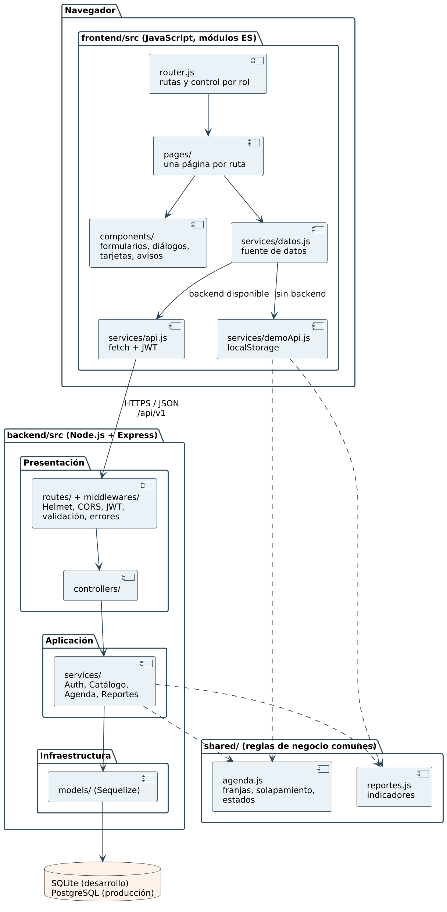
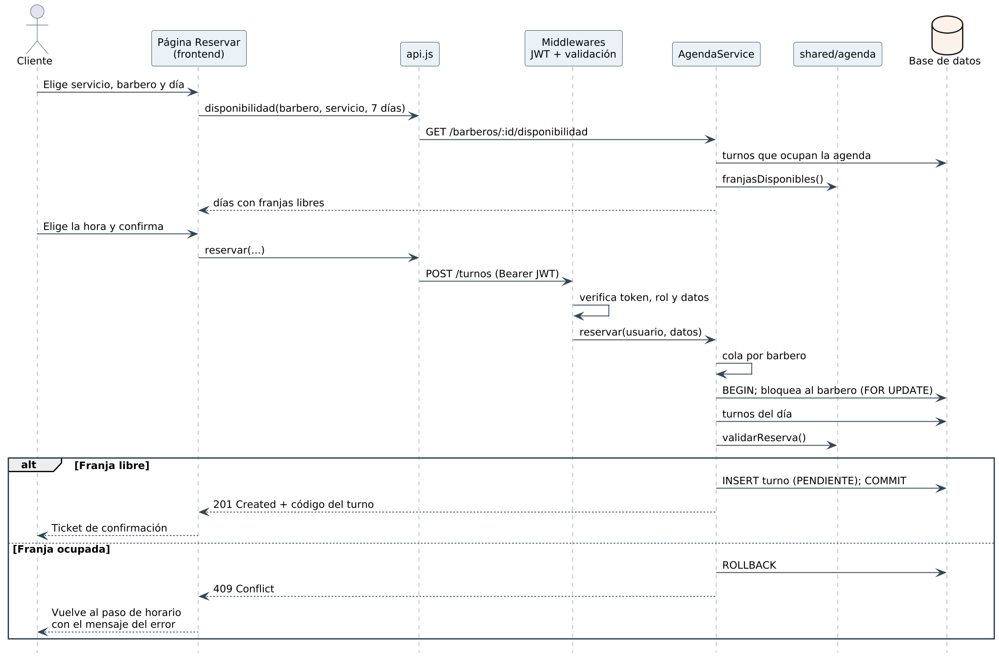
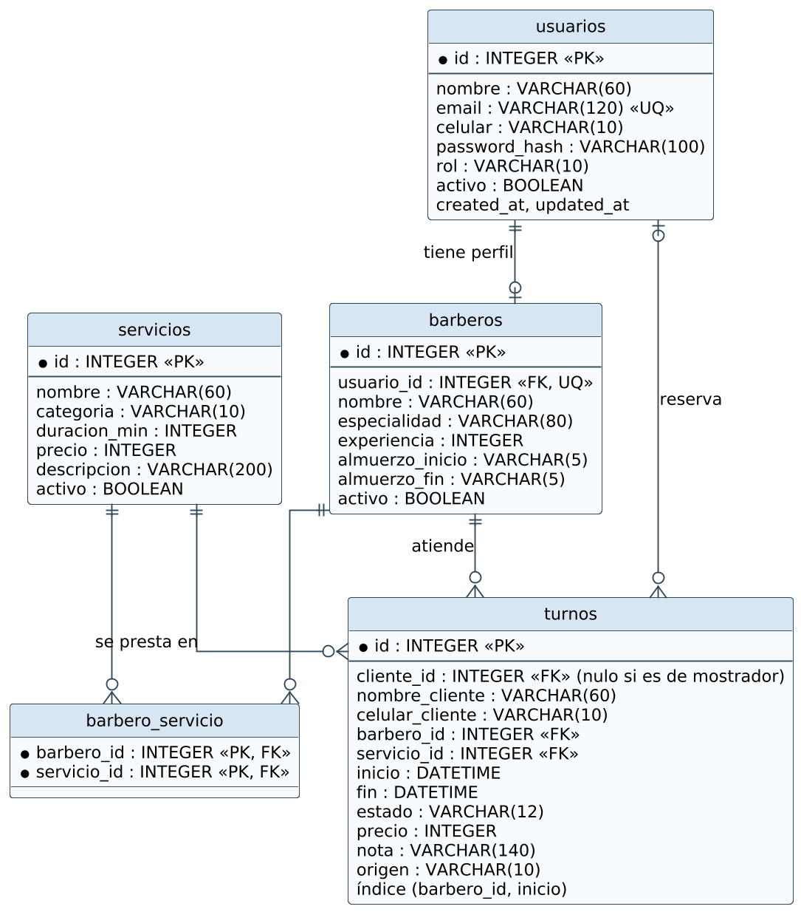
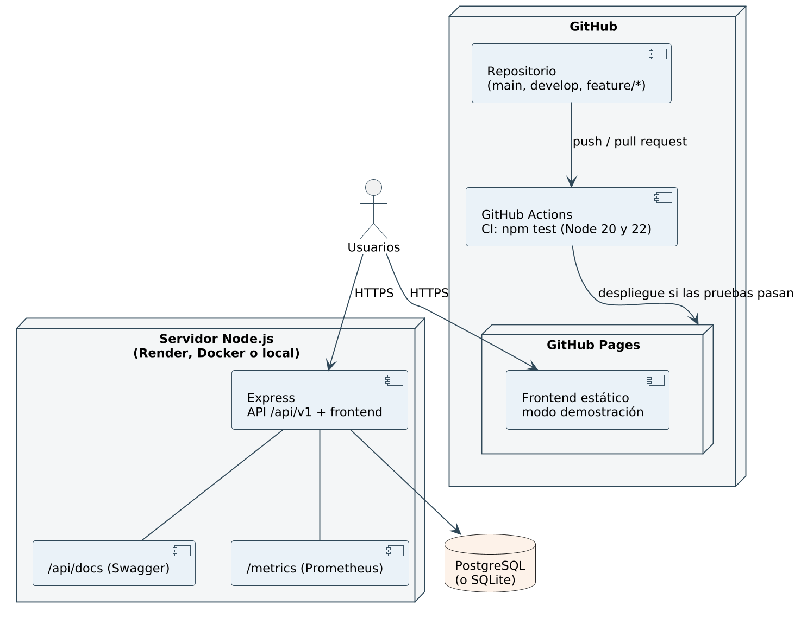

# Arquitectura final de CorteYa

## Visión general

CorteYa sigue una arquitectura **cliente-servidor**: una aplicación web de una sola página (SPA) en el navegador y una **API REST** en Node.js con Express. El backend está organizado en **capas** y el frontend por **componentes y páginas**. Las reglas de negocio de la agenda están en la carpeta `shared/` y las usan los dos lados.

## Componentes

| Componente | Ubicación | Responsabilidad |
|---|---|---|
| Páginas | `frontend/src/pages/` | Una por ruta: inicio, reservar, mis turnos, panel, administración de servicios y barberos, ingresar, registro y errores. |
| Componentes | `frontend/src/components/` | Piezas reutilizables: creación segura del DOM, campos de formulario con validación, diálogos, tarjetas, encabezado y avisos. |
| Enrutador | `frontend/src/router.js` | Rutas por hash (`#/panel`), control de acceso por rol y foco accesible al cambiar de página. |
| Capa de datos | `frontend/src/services/` | `datos.js` decide la fuente: `api.js` (API REST con JWT) o `demoApi.js` (navegador). Ambas exponen la misma interfaz. |
| Reglas compartidas | `shared/` | `agenda.js` (franjas, solapamiento, estados, cancelación), `reportes.js` (indicadores), `negocio.js` (horario y constantes) y `datosIniciales.js`. |
| Rutas y middlewares | `backend/src/routes/`, `backend/src/middlewares/` | Endpoints `/api/v1`, autenticación JWT, autorización por rol, validación con express-validator y manejo de errores. |
| Controladores | `backend/src/controllers/` | Traducen la petición HTTP a una llamada de servicio y eligen el código de respuesta. |
| Servicios | `backend/src/services/` | `AuthService`, `CatalogoService`, `AgendaService` y `ReporteService`: la lógica de aplicación. |
| Modelos | `backend/src/models/` | Modelos Sequelize y relaciones. |
| Base de datos | SQLite / PostgreSQL | SQLite en desarrollo y pruebas (sin instalación); PostgreSQL en producción con `DATABASE_URL`. |

## Flujo de información: reservar un turno

1. La página **Reservar** pide a `datos.barberos.disponibilidad()` las franjas de los próximos 7 días.
2. `api.js` llama a `GET /api/v1/barberos/:id/disponibilidad`. El `AgendaService` carga los turnos que ocupan la agenda y calcula las franjas con `shared/agenda.js`.
3. El cliente elige una hora y confirma. `api.js` envía `POST /api/v1/turnos` con el token en la cabecera `Authorization`.
4. Los middlewares verifican el token, el rol y los datos. El `AgendaService` pone la reserva en la cola del barbero, abre una transacción, bloquea la fila del barbero y vuelve a validar la franja.
5. Si la franja sigue libre, crea el turno en estado `PENDIENTE` y responde `201`. Si otra persona la tomó, responde `409` y la interfaz vuelve al paso de horario.

## Relación entre frontend y backend

- **Contrato:** API REST documentada con OpenAPI 3.0 (`backend/src/docs/openapi.yaml`), visible en `/api/docs`.
- **Formato de error uniforme:** `{ error: { status, mensaje, detalles: [{ campo, mensaje }] } }`. El frontend usa `detalles` para marcar cada campo del formulario.
- **Autenticación:** el token JWT se guarda en la sesión del navegador y viaja en `Authorization: Bearer`. Si la API responde `401`, la sesión se cierra.
- **Despliegue:** el mismo servidor Express sirve la API (`/api/v1`) y el frontend (archivos estáticos). Así se evita CORS y la CSP puede ser estricta.
- **Modo demostración:** si no hay backend (GitHub Pages), `datos.js` usa `demoApi.js`, que aplica las mismas reglas de `shared/` y los mismos permisos.

## Modelo de datos

- `usuarios`: todas las cuentas, con su rol (`CLIENTE`, `BARBERO`, `ADMIN`).
- `barberos`: perfil profesional; si el barbero tiene cuenta, `usuario_id` la enlaza.
- `servicios` y `barbero_servicio`: catálogo y servicios que presta cada barbero (muchos a muchos).
- `turnos`: el turno guarda el precio del momento de la reserva y el nombre del cliente. `cliente_id` es nulo en los turnos de mostrador.
- Hay un índice `(barbero_id, inicio)` para la consulta de disponibilidad, que es la más frecuente.

### Cambios respecto al documento maestro

| Documento maestro | Implementación final | Motivo |
|---|---|---|
| Tablas `horario_atencion` y `bloqueo_horario` | Horario general en `shared/negocio.js` y almuerzo en `barberos` | Para una barbería pyme el horario es el mismo para todo el equipo; se simplificó sin perder la regla. |
| Tabla `notificacion` y recordatorios | No implementado | Requiere un proveedor de correo o WhatsApp con credenciales; queda como mejora futura. |
| Tabla `refresh_token` | Token de acceso con expiración de 8 horas | Simplifica la sesión en el alcance del semestre (ver decisiones técnicas). |
| Tabla `negocio` | Constantes en `shared/negocio.js` | El producto atiende un negocio por instalación. |
| React como frontend | JavaScript con módulos ES | Ver la decisión técnica DT-02. |

## Seguridad

| Riesgo (OWASP) | Control |
|---|---|
| Inyección SQL | Sequelize con consultas parametrizadas; validación y tipado de todas las entradas. |
| XSS | El DOM se construye con `textContent` (nunca `innerHTML` con datos); CSP `script-src 'self'` sin scripts en línea; nombres validados con lista de caracteres permitidos. |
| CSRF | El token viaja en la cabecera `Authorization`, no en cookies, así que otro sitio no puede enviarlo. |
| Autenticación rota | bcrypt, mensajes que no revelan si un correo existe, límite de 20 intentos cada 15 minutos, tokens firmados con expiración. |
| Control de acceso roto (BOLA) | Cada servicio verifica que el turno pertenezca al cliente o al barbero; un cliente recibe `404` para turnos ajenos. |
| Configuración insegura | Helmet (CSP, HSTS, nosniff, frameguard), sin `x-powered-by`, CORS cerrado por defecto, límite de 20 KB por petición, secretos en variables de entorno. |
| Errores con información interna | Manejador central: mensajes genéricos para errores inesperados, sin trazas. |

## Despliegue

- **GitHub Actions:** `ci.yml` ejecuta las pruebas en Node 20 y 22 en cada cambio; `pages.yml` publica el frontend en GitHub Pages si las pruebas pasan.
- **Producto completo:** cualquier servidor con Node.js 20+ (`npm start`), Docker (`docker compose up`) o Render (`render.yaml`).
- **Observabilidad:** métricas en `/metrics` (formato Prometheus) y verificación de salud en `/api/v1/salud`.
