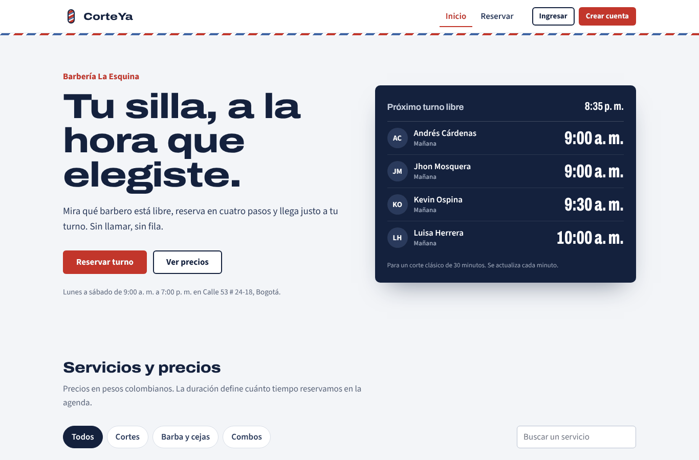
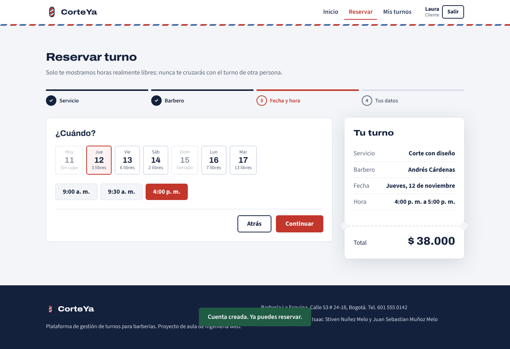
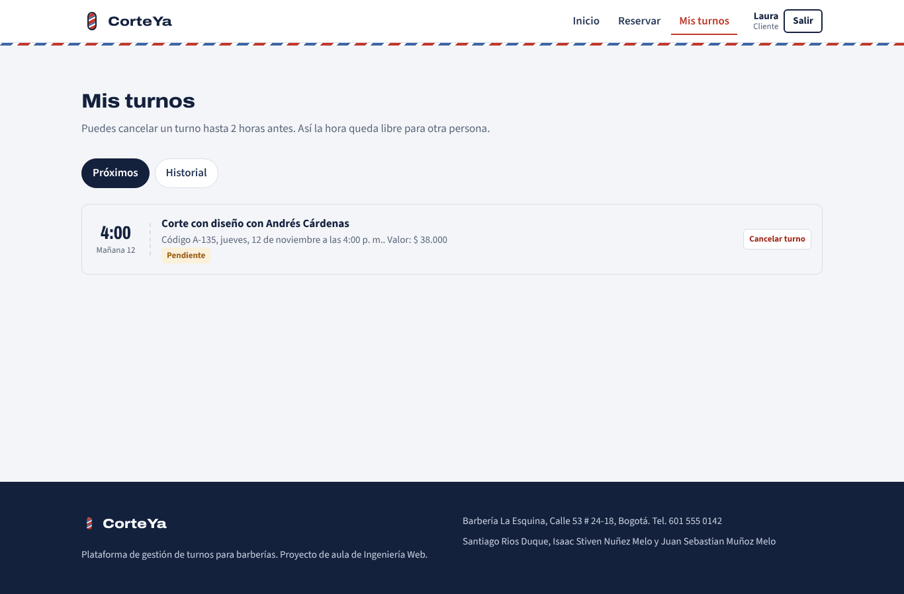
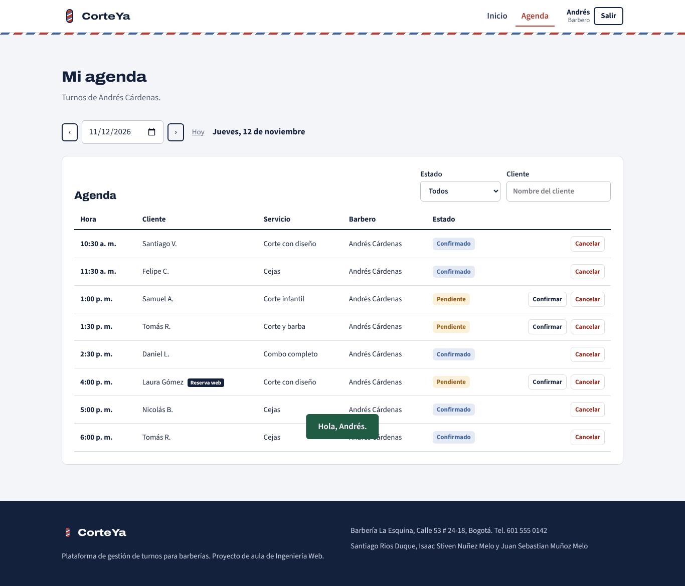
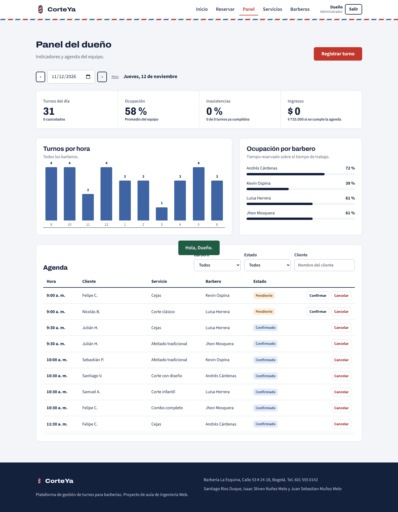
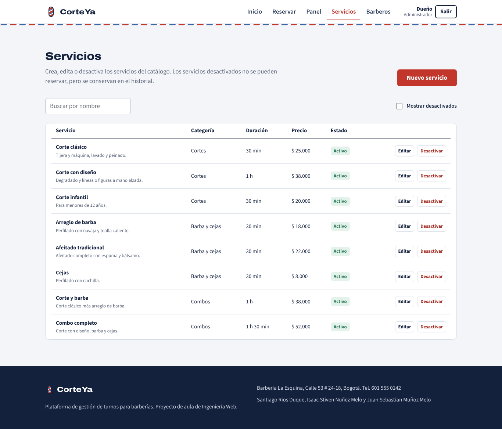

# Manual de usuario de CorteYa

CorteYa permite reservar turnos en la barbería desde el celular o el computador. Cada persona ve opciones distintas según su cuenta: **cliente**, **barbero** o **dueño**.

## 1. Entrar a la plataforma

- Si el producto corre en un servidor, abre la dirección que te compartieron (por ejemplo `http://localhost:3000`).
- En la versión publicada en GitHub Pages aparece una franja amarilla: **modo demostración**. Todo funciona igual, pero los datos se guardan solo en tu navegador.

### Cuentas de demostración

| Rol | Correo | Contraseña |
|---|---|---|
| Cliente | cliente@corteya.co | Cliente123* |
| Barbero | andres@corteya.co (también kevin@, luisa@, jhon@) | Barbero123* |
| Dueño | admin@corteya.co | Admin123* |

En la página **Ingresar** también están los botones **Entrar como cliente / barbero / dueño**.

## 2. Para clientes

### Ver servicios y barberos

En **Inicio** verás:

- **Próximo turno libre:** la siguiente hora disponible de cada barbero, que se actualiza cada minuto.
- **Servicios y precios:** filtra por categoría o escribe en el buscador.
- **El equipo:** la especialidad de cada barbero y su próximo espacio libre.

### Crear una cuenta

1. Pulsa **Crear cuenta**.
2. Escribe tu nombre, correo, celular (10 dígitos que empiecen por 3) y una contraseña de al menos 8 caracteres con letras y números.
3. Si algo está mal, el campo se marca en rojo y te dice cómo corregirlo.

### Reservar un turno

1. Pulsa **Reservar turno** (o **Reservar este servicio** en el catálogo).
2. **Servicio:** elige qué te vas a hacer.
3. **Barbero:** elige con quién. Los barberos que no hacen ese servicio aparecen deshabilitados.
4. **Fecha y hora:** elige el día y luego una de las horas libres. Solo aparecen horas realmente disponibles.
5. **Tus datos:** si quieres, deja una nota para el barbero y pulsa **Confirmar turno**.
6. Verás el **ticket** con el código del turno y el valor a pagar en la barbería.

Si alguien reservó esa misma hora un instante antes, CorteYa te avisa y te devuelve al paso de horario para que elijas otra.

### Ver y cancelar mis turnos

1. Abre **Mis turnos**. En **Próximos** están los turnos por venir y en **Historial**, los pasados y cancelados.
2. Para cancelar, pulsa **Cancelar turno** y confirma. Solo se puede cancelar hasta **2 horas antes**.

## 3. Para barberos

1. Ingresa con tu cuenta y abre **Agenda**.
2. Usa las flechas o el calendario para cambiar de día, o **Hoy** para volver al día actual.
3. Filtra por estado o busca por el nombre del cliente.
4. Acciones sobre cada turno:
   - **Confirmar** o **Cancelar** un turno pendiente.
   - **Atendido** o **No asistió**, cuando el turno ya empezó.

## 4. Para el dueño (administrador)

### Panel

En **Panel** verás los indicadores del día elegido:

- **Turnos del día** y cancelados.
- **Ocupación:** porcentaje del tiempo de trabajo que está reservado.
- **Inasistencias:** porcentaje de clientes que no llegaron, sobre los turnos ya cumplidos.
- **Ingresos:** lo cobrado (turnos atendidos) y lo esperado si se cumple la agenda.
- **Turnos por hora** (la barra roja es la hora actual) y **ocupación por barbero**.
- **Agenda** de todo el equipo, con filtros por barbero, estado y cliente.

### Registrar un turno de mostrador

Cuando un cliente llama o llega al local, pulsa **Registrar turno**. El proceso es el mismo de la reserva, y al final escribes el nombre del cliente y, si quieres, su celular.

### Servicios

En **Servicios** puedes:

- **Nuevo servicio:** nombre, categoría, duración (múltiplos de 30 minutos) y precio.
- **Editar:** cambiar cualquier dato o reactivar un servicio.
- **Desactivar:** deja de aparecer en el catálogo, pero los turnos registrados no cambian.
- **Mostrar desactivados:** ver también los servicios inactivos.

### Barberos

En **Barberos** puedes crear, editar o desactivar barberos, elegir los servicios que presta cada uno y su hora de almuerzo. En la hora de almuerzo no se ofrecen turnos.

## 5. Preguntas frecuentes

- **¿Por qué no veo horas en un día?** El día está lleno, es domingo (la barbería no atiende) o el barbero no presta ese servicio.
- **¿Por qué no puedo cancelar?** Faltan menos de 2 horas para el turno; comunícate con la barbería.
- **Me sacó de la sesión.** La sesión dura 8 horas; ingresa de nuevo.
- **Aparece "No hay conexión con el servidor".** Revisa tu internet y pulsa **Intentar de nuevo**.
